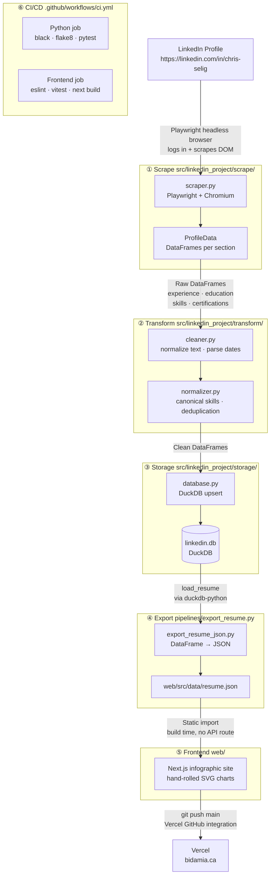

# LinkedIn Resume AI

> An end-to-end data engineering project — scrape, transform, and present a LinkedIn profile as an infographic-style web application, fully automated with CI/CD.

**Live site:** bidamia.ca (Vercel — see [deployment notes](docs/deployment.md))

---

## What This Project Demonstrates

This project was built to showcase a complete, production-quality workflow spanning data engineering and frontend development — from raw data collection through to a deployed, designed web application.

| Skill Area | Technologies Used |
|---|---|
| **Data Collection** | Playwright (headless Chromium), DOM scraping, browser automation |
| **Data Engineering** | pandas (vectorized operations), data cleaning, normalization, schema design |
| **Data Storage** | DuckDB, parameterized SQL, upsert patterns |
| **Frontend** | Next.js, TypeScript, Tailwind CSS, hand-rolled SVG data visualization (no charting library) |
| **Design** | Infographic visual language — restrained color, typography-driven hierarchy, concept-first layout |
| **Software Engineering** | PEP 8, type hints, docstrings, modular package design |
| **Testing** | pytest (Python pipeline), Vitest (frontend), mocked browser/DB, 100+ unit tests |
| **CI/CD** | GitHub Actions, automated lint + test on PRs |
| **Deployment** | Vercel (static Next.js build), custom domain |

---

## How It Works

The project is two halves: a Python data pipeline that only ever produces data, and a Next.js site that only ever reads it. There is no server-side Python in production.



### ① Scrape — `src/linkedin_project/scrape/`

A headless Chromium browser (Playwright) logs in to LinkedIn and navigates to the target profile. The scraper scrolls to trigger lazy-loaded content, clicks "Show all" sections, and extracts structured data via CSS selectors. Each section (experience, education, skills, certifications) is returned as a pandas DataFrame with a typed schema defined in `schema.py`.

**Why Playwright?** The unofficial LinkedIn API requires authentication and is frequently blocked. A real browser that mimics human navigation is significantly more reliable.

### ② Transform — `src/linkedin_project/transform/`

Raw DataFrames pass through two stages:
- `cleaner.py` — strips whitespace, parses ISO 8601 dates, normalizes company names
- `normalizer.py` — maps skills to a 60+ entry canonical list, deduplicates rows, standardizes date ranges

All operations use vectorized pandas — no row-level loops.

### ③ Storage — `src/linkedin_project/storage/`

Cleaned DataFrames are upserted into a local DuckDB file (`data/duckdb/linkedin.db`). All SQL uses parameterized queries (no string interpolation). Table names are validated against an allowlist; column names in WHERE clauses are validated as alphanumeric-only to prevent injection.

**Why DuckDB?** Zero-configuration, embedded, and optimized for analytical queries on DataFrames.

### ④ Export — `src/linkedin_project/pipelines/export_resume.py`

Reads from DuckDB if populated, falling back to sample data otherwise. `scripts/export_resume_json.py` writes the result to `web/src/data/resume.json` — a committed, build-time data file. This is the only hand-off between the Python pipeline and the frontend.

### ⑤ Frontend — `web/`

A Next.js (TypeScript + Tailwind) site renders the resume as infographic sections instead of a conventional document layout — a bold typography-led hero, a hand-rolled SVG circle-packing chart for skills (sized by endorsement count), a timeline for experience, and card layouts for education/certifications. The visual language (restrained 2-hue palette, typography as hierarchy, concept-first design) follows principles extracted from David McCandless's *Information is Beautiful*.

### ⑥ CI/CD — `.github/workflows/ci.yml`

Every pull request runs two jobs: the Python pipeline (`black --check`, `flake8`, `pytest --cov=src`) and the frontend (`eslint`, `vitest`, `next build`). Deploys to Vercel happen via Vercel's own GitHub integration on push to `main` — not a custom Actions workflow.

---

## Running Locally

**Python pipeline:**

```bash
python3 -m venv .venv && source .venv/bin/activate
pip install -r requirements.txt
pip install -e ".[dev]"
playwright install chromium

# Scrape your LinkedIn profile (optional — falls back to sample data)
export LINKEDIN_USERNAME="your@email.com"
export LINKEDIN_PASSWORD="yourpassword"
export LINKEDIN_PROFILE="chris-selig"
python scripts/scrape_linkedin.py

# Export resume data for the frontend
python scripts/export_resume_json.py
```

**Frontend:**

```bash
cd web
npm install
npm run dev   # http://localhost:3000
```

---

## Project Structure

```
.
├── web/                         # Next.js infographic site (the deployed app)
│   ├── src/app/                 # App Router page + layout
│   ├── src/components/          # Hero, SkillsBubbleChart, ExperienceTimeline, …
│   ├── src/lib/                 # Typed resume loader, circle-pack layout math
│   └── src/data/resume.json     # Generated — do not edit by hand
├── src/linkedin_project/
│   ├── scrape/                  # Playwright scraper + schema definitions
│   ├── transform/                # Data cleaning and normalization
│   ├── storage/                  # DuckDB read/write
│   └── pipelines/                # Orchestration, including export_resume.py
├── scripts/
│   ├── scrape_linkedin.py        # CLI entry point for scraping
│   └── export_resume_json.py     # Writes web/src/data/resume.json
├── tests/                        # Python pipeline tests (pytest)
├── .github/workflows/
│   └── ci.yml                    # PR: lint + test, both pipeline and frontend
└── docs/
    ├── architecture.md           # Detailed architecture notes
    └── deployment.md             # Vercel + bidamia.ca setup
```

---

## Key Engineering Decisions

| Decision | Rationale |
|---|---|
| Playwright over requests/API | LinkedIn blocks API clients; a real browser is far more reliable |
| DuckDB over SQLite/Postgres | Zero-config, columnar, native pandas integration, analytical queries |
| Static JSON hand-off, no API | Resume content changes rarely; a build-time import needs no server, no auth, no runtime failure mode |
| Hand-rolled SVG over a chart library | A handful of custom infographic shapes don't justify a dependency — see `web/src/lib/circlePack.ts` |
| Parameterized SQL everywhere | Prevents SQL injection; table/column names validated against allowlists |
| Vectorized pandas only | No row-level loops — all transforms use apply/map/merge on full columns |

---

## Documentation

- [Architecture](docs/architecture.md) — detailed data flow and layer responsibilities
- [Deployment](docs/deployment.md) — Vercel setup and the bidamia.ca custom domain
- [Data directory](data/README.md) — data file conventions
